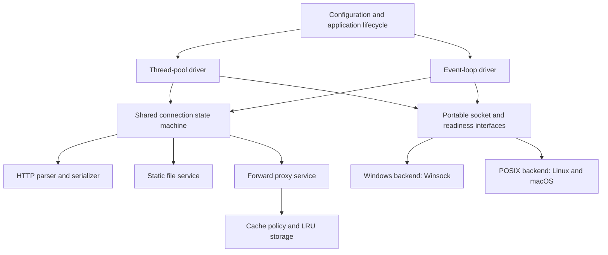

# HTTP/1.1 Server and Forward Caching Proxy

## 1. Project overview

This project implements an HTTP/1.1 static file server and a forward caching proxy in **C++20**, using TCP sockets directly. **CMake** will configure the build and select platform implementations; **Ninja** will execute the generated build rules.

The project has three learning goals:

1. Understand HTTP by implementing message parsing, framing, connection management, and response generation.
2. Understand proxy caching by implementing freshness checks, conditional requests, and an LRU eviction policy.
3. Measure how a thread pool and an event loop behave under increasing client concurrency.

**Document status (2026-10-27):** original architecture/design reference, preserved alongside the integrated implementation. A–K and L application assembly are implemented. M qualification and N candidate reporting are documented in `docs/validation/lmn.md`. Signature sketches and CLI examples below describe the original design; use the tracked `README.md` and `docs/configuration.md` for actual factories, targets and executable options. Final native-platform qualification and performance acceptance require the evidence in the M/N handoffs.

### Technology and scope

| Area | Decision |
| --- | --- |
| Language | C++20, including RAII, move semantics, `std::span`, standard threads, and `std::chrono` |
| Build | CMake 3.20 or newer, Ninja, and a C++20-capable compiler |
| Target platforms | Windows using Winsock; Linux and macOS using POSIX sockets |
| Runtime dependencies | C++ standard library and operating-system APIs |
| HTTP implementation | Written in this project; no HTTP server, proxy, parser, or client library in the runtime |
| Application modes | `server` for local files; `proxy` for forwarding to HTTP origins |
| Concurrency modes | `thread-pool` and `event-loop`, selectable at startup |
| Cache | Shared, in-memory, bounded by bytes and entry count |

The first version will support cleartext HTTP/1.1 and GET/HEAD. HTTPS, TLS, CONNECT tunnels, protocol upgrades, HTTP/2, HTTP/3, dynamic application handlers, cache persistence, and generated compression are outside the initial scope. External clients and load generators may be used to test the implementation.

## 2. Overall architecture

Application behavior and concurrency are separate choices. Both execution models must use the same HTTP parser, server handler, proxy handler, and cache policy.



The HTTP layer operates on byte buffers and message objects. It does not include Winsock or POSIX headers. A connection state machine produces actions such as reading more bytes, writing a buffer, resolving a host, opening a file, or closing a connection. The selected driver executes those actions and returns results to the state machine.

This separation allows the same fragmented byte stream to be tested without a network, and prevents the two concurrency implementations from developing different HTTP behavior.

### Proposed repository layout

```text
httpserver/
|-- CMakeLists.txt
|-- PROJECT_ARCHITECTURE.md
|-- include/
|   |-- core/          # Result, errors, configuration, clocks, identifiers
|   |-- net/           # Runtime, Socket, Endpoint, Resolver, Poller
|   |-- http/          # Messages, parser, framing, serializer, dates
|   |-- server/        # StaticFileService, MIME lookup, path policy
|   |-- proxy/         # Target parsing, forwarding, upstream transactions
|   |-- cache/         # CachePolicy, CacheEntry, LruCache
|   |-- concurrency/   # ConnectionSession, Driver, work queues
|   `-- observability/# Counters, timing, logging
|-- src/
|   |-- main.cpp
|   |-- core/
|   |-- net/
|   |   |-- windows/   # Winsock runtime, sockets, WSAPoll adapter
|   |   `-- posix/     # POSIX sockets, poll adapter
|   |-- http/
|   |-- server/
|   |-- proxy/
|   |-- cache/
|   |-- concurrency/
|   `-- observability/
|-- tests/            # Unit, socket, and end-to-end tests
|-- benchmarks/       # Workload definitions, commands, and raw results
`-- www/              # Example static document root
```

## 3. Operating-system-independent function architecture

OS independence means that callers use the same types and function contracts on each platform. It does not mean the underlying socket calls are identical. Platform differences belong in `src/net/windows/`, `src/net/posix/`, and CMake source selection.

### 3.1 Portable types and ownership

- `Result<T>` contains either a value or an `Error`; `Result<void>` represents success or error. Implement it using C++20 facilities such as `std::variant`; `std::expected` is not part of C++20.
- `Error` contains a portable category, operation name, and optional native error code for diagnostics. Application decisions use the portable category.
- `Endpoint` stores an IPv4 or IPv6 address and port without exposing `sockaddr` in public headers. `HostPort` stores an unresolved name and port.
- `Socket` is move-only and owns exactly one native socket. Destruction closes it; moving transfers ownership. A failed operation never returns an apparently valid socket.
- `NetworkRuntime` owns process-level networking initialization and outlives sockets and worker threads.
- `ConnectionId` and `RegistrationToken` include generations so that delayed events cannot target a newly reused socket handle.
- `Deadline` uses `std::chrono::steady_clock`. HTTP dates use wall-clock time through a separately injected `Clock` interface.

Use an opaque implementation object, such as `std::unique_ptr<Impl>`, to keep native handles out of public headers. Define its destructor and move operations out of line. The poller backend may access the handle internally; HTTP and cache modules must not.

### 3.2 Networking API contracts

The following signatures describe the proposed interface. Supporting types and class definitions will be implemented separately.

```cpp
// Signature sketch: Result, Endpoint, Error, and event types are project types.
Result<NetworkRuntime> initialize_network();
Result<std::vector<Endpoint>> resolve(HostPort target);

Result<Socket> create_tcp_socket(AddressFamily family);
Result<void> bind(Socket& socket, const Endpoint& local);
Result<void> listen(Socket& socket, int backlog);
Result<Socket> accept(Socket& listener);
Result<void> set_nonblocking(Socket& socket, bool enabled);

Result<ConnectState> begin_connect(Socket& socket, const Endpoint& remote);
Result<void> finish_connect(Socket& socket);
ReadResult read_some(Socket& socket, std::span<std::byte> destination);
WriteResult write_some(Socket& socket, std::span<const std::byte> source);
Result<void> shutdown_write(Socket& socket);
void close(Socket& socket) noexcept;

Result<RegistrationToken> watch(Poller& poller, Socket& socket,
                               Interest interest, ConnectionId owner);
Result<void> modify(Poller& poller, RegistrationToken token,
                    Interest interest);
Result<void> unwatch(Poller& poller, RegistrationToken token);
Result<std::vector<ReadyEvent>> wait(Poller& poller, Deadline deadline);
Result<void> wake(Poller& poller);
```

| Function or result | Contract shared by all platforms |
| --- | --- |
| `initialize_network()` | Initialize the backend once for the application lifecycle; release it after all networking work stops. |
| `resolve()` | Return candidate addresses for a host. This operation may block and must run outside the event-loop thread. |
| `accept()` | Return an owned socket or a classified error such as `would_block`. Configure every accepted socket explicitly. |
| `begin_connect()` | Return `connected`, `in_progress`, or an error. Each failed address attempt uses a fresh socket. |
| `finish_connect()` | Check the socket's pending error after readiness; write readiness alone does not prove connection success. |
| `read_some()` | Return bytes read, peer EOF, would-block, or error as distinct outcomes. Use nonempty buffers. |
| `write_some()` | Return bytes accepted, would-block, or error. A short write is normal; the caller retains the unsent suffix. |
| `wait()` | Return readable, writable, hangup, and error events, or an empty list on deadline expiry. |
| `wake()` | Interrupt a readiness wait when work completes or shutdown is requested. |
| `close()` | Be safe on an already closed or moved-from wrapper. Unregister sockets before closing them. |

No parser or handler should use a Boolean return value to represent all of EOF, would-block, timeout, and failure. The initial `net::Socket` interface can evolve into this wrapper while preserving its move-only ownership model.

### 3.3 Platform implementation mapping

| Operation | Windows implementation | Linux/macOS implementation |
| --- | --- | --- |
| Native socket type | `SOCKET`, invalid value `INVALID_SOCKET` | File descriptor `int`, invalid value `-1` |
| Runtime initialization | `WSAStartup`, balanced with `WSACleanup` | No socket subsystem startup required |
| Create/listen/accept/connect | Winsock socket functions | POSIX socket functions |
| Close | `closesocket` | `close` |
| Error capture | Usually `WSAGetLastError`; startup returns its own error | `errno` |
| Nonblocking mode | `ioctlsocket` with `FIONBIO` | `fcntl` with `O_NONBLOCK` |
| Baseline readiness | `WSAPoll` | `poll` |
| Host resolution | `getaddrinfo`, `freeaddrinfo` | `getaddrinfo`, `freeaddrinfo` |
| Threads and locks | `std::thread`, `std::mutex`, `std::condition_variable` | Same C++ interfaces |

Winsock initialization and error behavior are described in Microsoft's [startup documentation](https://learn.microsoft.com/en-us/windows/win32/api/winsock2/nf-winsock2-wsastartup) and [porting guide](https://learn.microsoft.com/en-us/windows/win32/winsock/porting-socket-applications-to-winsock).

Normalize interrupted calls inside the adapter, respecting deadlines. Capture errors immediately. Cap individual buffer lengths to what each native API accepts. Suppress `SIGPIPE` within the POSIX implementation using the supported platform mechanism so a disconnected client becomes an I/O error.

The baseline poller uses level-triggered readiness: keep reading or writing until would-block or a fairness budget is reached. Register write interest only when output is pending or a connection is in progress. Use a socket-based wakeup channel on both platforms, and handle buffered readable data even when hangup is also reported. See [WSAPoll](https://learn.microsoft.com/en-us/windows/win32/api/winsock2/nf-winsock2-wsapoll) and [poll](https://man7.org/linux/man-pages/man2/poll.2.html).

Linux `epoll` and BSD/macOS `kqueue` can later implement the same readiness interface. Windows IOCP uses completion semantics and would require a separate completion-oriented driver; it is not a drop-in readiness implementation.

### 3.4 Other portability boundaries

`FileService` uses `std::filesystem` and binary file streams behind a small interface for metadata and bounded reads. File access can block even when sockets are nonblocking. A bounded helper pool executes file and DNS work for the event loop and posts completion events through `wake()`.

Keep command-line parsing, MIME lookup, HTTP-date parsing, cache policy, and metrics aggregation in portable C++. Isolate OS signal/console shutdown hooks and process CPU/memory measurements behind small adapters. Use a controlled, read-only document root for the initial implementation; stronger filesystem containment against concurrent path replacement may need native file-opening APIs.

## 4. Shared application functions

| Module | Main functions | Responsibility |
| --- | --- | --- |
| HTTP parser | `consume(bytes)`, `finish_on_eof()`, `reset()` | Incremental parsing; report consumed bytes, headers, body fragments, completion, or error. |
| Framing | `select_body_framing(message, context)` | Choose no-body, fixed-length, chunked, or upstream close-delimited processing. |
| Serializer | `serialize_head(message)`, `encode_chunk(bytes)` | Generate validated headers and bounded output fragments. |
| Static server | `prepare_response(request)`, `read_file_chunk(handle)` | Resolve paths, select status and MIME type, and stream file content. |
| Proxy | `parse_target(request)`, `prepare_upstream_request(request)` | Select an upstream and prepare forwarding headers. |
| Cache policy | `may_store(request, response)`, `evaluate(entry, request, clock)` | Return bypass, hit, revalidate, fetch, or cache-only failure. |
| Cache storage | `lookup(key)`, `insert(entry)`, `erase(key)` | Own entries and maintain recency and capacity. |
| Session | `on_event(event)` | Advance one connection and emit driver actions. |
| Driver | `run(config)`, `request_stop()` | Schedule sessions, execute I/O, enforce deadlines, and shut down. |

Separate decisions from effects. For example, `CachePolicy::evaluate()` decides that validation is required; it does not open a socket. `StaticFileService::prepare_response()` produces metadata and a body source; it does not send bytes.

## 5. HTTP parsing and response generation

### Incremental processing

TCP delivers a byte stream, so one read may contain a partial header or several requests. Keep input buffers per connection and preserve bytes after a completed message. Store repeated header fields without blindly joining fields whose syntax forbids it.

```text
start line -> headers -> body framing selection
                         |-> no body -> complete
                         |-> fixed-length body -> complete
                         `-> chunk size -> chunk data -> next chunk
                                               `-> zero chunk -> trailers -> complete
```

For the initial parser, reject ambiguous framing, malformed lengths, obsolete folded headers, and invalid header syntax. Require a valid HTTP/1.1 `Host`. Reject requests containing both `Transfer-Encoding` and `Content-Length`, then close. Support chunked coding with bounded extensions and trailers; reject unsupported codings. Never emit both framing headers.

HEAD, informational responses, 204, and 304 have no response body. A request without a framing header has no body; an upstream response can be close-delimited. Persistence requires consuming the request body or closing the connection. These framing boundaries follow [RFC 9112](https://www.rfc-editor.org/rfc/rfc9112.html#section-6).

The parser supports fixed-length and chunked bodies, but the first application version accepts only bodyless GET/HEAD requests. Reject a nonempty request body and close instead of leaving bytes to be mistaken for another request. An unsupported `Expect` request receives 417 and closes. This is an explicit project restriction.

Use configurable limits for start-line length, header bytes/count, trailer bytes/count, decoded body size, connection input buffers, and output queues. Check numeric overflow before allocation. Return 413 for a body limit and 431 for a header limit where a response can still be sent safely.

### Persistent connections and output

Process one request at a time per connection, keeping later pipelined bytes buffered within a limit. Responses remain ordered. Honor `Connection: close`, enforce idle and progress deadlines, and close after framing errors.

Use `Content-Length` for known-length bodies and chunked encoding for supported unknown-length streams. Keep a write offset until all bytes are sent. If an upstream body fails after downstream headers have been sent, close the downstream connection; do not append a second error response or a successful final chunk.

### Static file service

1. Split the request path from its query before filesystem lookup. Decode URL escapes once and reject invalid encodings, NULs, backslashes, Windows drive/UNC/device forms, and alternate data stream syntax.
2. Resolve the candidate under a canonical document root and compare path components for containment. Do not use a string-prefix check. Apply a defined symlink policy; initially reject symlinks/reparse points and serve a controlled tree.
3. Open files in binary mode. Map `/` to `index.html`; disable directory listings.
4. Determine MIME type from an explicit extension table. Examples: `.html` -> `text/html`, `.css` -> `text/css`, `.js` -> `text/javascript`, `.json` -> `application/json`, `.png` -> `image/png`. Fall back to `application/octet-stream`.
5. Prepare GET metadata and stream bounded file chunks. HEAD sends the corresponding metadata with no body; its length, if supplied, describes GET.

Generate `Date`, `Content-Type`, and appropriate framing. Support `Last-Modified` and an ETag for conditional GET tests. A size/mtime-derived ETag must be weak; a strong tag requires a scheme that guarantees byte equivalence. Evaluate `If-None-Match` before `If-Modified-Since`, including weak matching for GET/HEAD. A matching condition produces 304. See [RFC 9110: HEAD](https://www.rfc-editor.org/rfc/rfc9110.html#section-9.3.2) and [conditional requests](https://developer.mozilla.org/en-US/docs/Web/HTTP/Guides/Conditional_requests).

### Status mapping

| Status | Planned use |
| --- | --- |
| 200 OK | File response or successful forwarded/cached response |
| 304 Not Modified | Successful client conditional GET/HEAD |
| 400 Bad Request | Invalid syntax, ambiguous framing, or rejected GET/HEAD body |
| 403 Forbidden | Forbidden path or file access |
| 404 Not Found | Missing file |
| 405 Method Not Allowed | Recognized method disabled for the resource; send `Allow: GET, HEAD` |
| 408 Request Timeout | Client request deadline expires, if a response is still possible |
| 413 / 414 / 431 | Body, request target, or header limits exceeded |
| 417 Expectation Failed | Unsupported expectation |
| 500 Internal Server Error | Unexpected local failure |
| 501 Not Implemented | Unknown/unimplemented method or unsupported transfer coding where applicable |
| 502 Bad Gateway | Upstream resolution/connect failure or invalid response |
| 503 Service Unavailable | Capacity exhausted, when a bounded rejection response is possible |
| 504 Gateway Timeout | Upstream deadline expires, or a cache-only request cannot be satisfied |
| 505 HTTP Version Not Supported | Unsupported HTTP version |

Reject CONNECT and Upgrade behavior explicitly. An invalid request transfer-coding sequence whose final coding is not chunked is a 400 framing error. An invalid upstream message becomes 502 only if the downstream response has not started. These distinctions belong in the shared HTTP layer.

## 6. Forward proxy behavior

The client explicitly configures this process as its HTTP proxy. A normal request uses an absolute target such as `http://example.com:8080/assets/logo.png?size=small`.

For each accepted request:

1. Parse the HTTP scheme, authority, effective port, path, and query. Reject userinfo and fragments. Support bracketed IPv6 authorities. The initial proxy requires absolute-form targets; the origin server accepts origin-form and absolute-form.
2. Consult the cache policy for GET, then resolve and connect if forwarding is required.
3. Send an origin-form target to the origin and regenerate `Host` from the selected authority. Remove `Connection` and all fields it names, along with other hop-specific fields. Consume proxy credentials locally rather than forwarding them. Append `Via` and detect loops.
4. Parse the response incrementally and select downstream framing independently. Preserve end-to-end metadata and opaque content encodings. Handle informational responses before the final response; reject protocol switching.
5. Stream bounded body fragments to the client. Commit a cache entry only after a complete eligible response is received.

Forwarding and connection-specific field handling follow [RFC 9110 section 7.6](https://www.rfc-editor.org/rfc/rfc9110.html#section-7.6). The trailer parser validates and bounds trailers separately; optional unsupported trailers may be discarded, and trailers must never redefine framing or routing metadata.

Maintain separate client and upstream state. Start with one upstream connection per forwarded transaction; client keep-alive still works. Upstream connection pooling can be added after correctness tests. For close-delimited responses, relay until EOF without treating that upstream connection as reusable, and initially bypass cache storage for them.

Backpressure is required: pause upstream reads when the downstream output buffer is full, and resume below a low-water mark. Stop buffering a cache candidate when it exceeds the object limit while continuing to forward it. Bound DNS jobs, open upstream sockets, and pending connection attempts.

## 7. HTTP cache and LRU storage

### Storage model and initial policy

HTTP cache policy decides whether a response can be stored and reused. LRU decides which stored entry to evict when space is needed. Freshness and recency are separate concepts.

The initial cache stores complete **200 responses to unconditional GET requests**. Cache eligibility is deliberately conservative:

- Bypass requests with `Authorization`, `Cookie`, `Range`, or client conditionals. Forward their semantics unchanged when otherwise supported.
- Bypass responses with `Set-Cookie` or any `Vary`, including `Vary: *`. This avoids implementing variant storage in the first milestone.
- Forward HEAD without caching or replacing a GET body.
- Do not store partial, oversized, malformed, or interrupted responses.

These are project simplifications, not a claim that HTTP prohibits caching every such response. A later version can add variant keys, authenticated cache rules, range assembly, and cache-side client conditional evaluation.

The key is `(scheme, normalized host, effective port, exact path and query)`. Preserve query order and escaped path distinctions; normalize only components whose equivalence is established. Store transfer-decoded body bytes while retaining any content encoding.

Each `CacheEntry` holds the key, status, end-to-end headers, immutable body, byte cost, ETag, Last-Modified value, freshness information, and timing data. Do not store a raw response containing another connection's framing or hop-specific headers.

### Freshness and directives

| Input | Initial behavior |
| --- | --- |
| Response `no-store` or `private` | Do not store in this shared cache. |
| Request `no-store` | Conservatively bypass both lookup and insertion. |
| Request/response `no-cache` | Validate before reuse, even if the entry appears fresh. |
| Response `s-maxage`, then `max-age`, then `Expires` | Use the first applicable explicit freshness lifetime. |
| No explicit lifetime | Treat as immediately stale; retain only useful candidates for validation. |
| Request `max-age` / `min-fresh` | Apply the client's additional freshness constraints. |
| Request `only-if-cached` | Return a usable cached response or 504; never contact the origin. |
| `must-revalidate` / `proxy-revalidate` | Require validation when stale. The initial policy never serves stale data. |
| Request `max-stale` | Do not use its optional permission to serve stale data. |

Parse directive names case-insensitively and handle quoted values. Treat malformed or conflicting freshness values conservatively. For unsupported field-qualified `private` or `no-cache`, apply the restriction to the entire response. See the [Cache-Control reference](https://developer.mozilla.org/en-US/docs/Web/HTTP/Reference/Headers/Cache-Control).

Track age instead of restarting a full freshness lifetime on insertion. With all durations in seconds:

```text
apparent_age         = max(0, response_wall_time - Date)
response_delay       = response_monotonic_time - request_monotonic_time
corrected_initial_age = max(apparent_age, received_Age + response_delay)
current_age          = corrected_initial_age
                     + (now_monotonic - response_monotonic_time)
fresh                = current_age < freshness_lifetime
```

Record wall and monotonic timestamps together; use monotonic time for elapsed durations. Handle absent/invalid date metadata conservatively, clamp arithmetic, and generate an updated `Age` when serving a stored response. Storage, age, and reuse rules are specified in [RFC 9111](https://www.rfc-editor.org/rfc/rfc9111.html#section-4).

### Revalidation workflow

```text
request -> evaluate cache eligibility and request constraints
        -> eligible, usable fresh entry? -> serve cached response
        -> cache-only request? -> 504
        -> policy bypass? -> forward without using/storing cache
        -> stale entry with validator? -> conditional upstream GET
        -> otherwise -> ordinary upstream GET
```

Use the stored ETag in `If-None-Match`; use `If-Modified-Since` from Last-Modified when no ETag is available. Preserve validator syntax, including weak ETags. On a matching upstream 304, merge permitted metadata, recalculate age/freshness, and retain the body. For an unconditional client GET, serve the resulting cached 200 response. An unexpected or mismatching 304 requires a new unconditional fetch or an upstream error, never reuse of an unrelated body. A new 200 replaces the entry only after full validation and receipt. See [RFC 9111 validation](https://www.rfc-editor.org/rfc/rfc9111.html#section-4.3).

If revalidation changes cache eligibility, remove the stored entry. Invalidate the old entry on an authoritative changed response that cannot replace it. On upstream failure, return an error instead of stale content. Apply `only-if-cached` before any bypass path attempts network access.

### LRU and synchronization

Use `std::unordered_map<Key, Node>` plus a recency `std::list<Key>` for average O(1) lookup, promotion, and eviction. Each node owns an immutable entry through `std::shared_ptr<const CacheEntry>` and a list iterator.

Protect map/list changes with one mutex initially. Copy a shared pointer under the lock, then release the lock before serialization or I/O. A response can finish using an entry even after eviction. Account separately for resident entries, in-flight response references, and partially accumulated cache candidates; eviction alone does not release pinned memory.

Enforce entry count, resident byte budget, per-object limit, and a global in-flight memory budget. Duplicate concurrent misses are acceptable initially and must be recorded in benchmarks. Request coalescing can be a later optimization.

## 8. Concurrency models

### Thread pool

One acceptor feeds a bounded queue of connections to a fixed number of workers. Each worker owns one client session at a time, including its current upstream transaction. It drives the shared state machine, waiting for readiness when I/O cannot progress. Thus workers may block in waits while the socket operations themselves retain the same nonblocking contracts.

Use `std::thread`, `std::mutex`, and `std::condition_variable`. Enforce per-connection deadlines and a keep-alive request limit so idle clients cannot occupy workers indefinitely. Queue saturation must trigger a bounded rejection or close. A worker must not wait for a job queued to its own saturated pool; use a separate helper service for file/DNS work if asynchronous jobs are shared with the event-loop implementation.

Expected tradeoff: straightforward connection ownership and potential multicore execution, with worker capacity consumed by slow clients and upstream waits. This is a hypothesis to measure, not a performance guarantee.

### Event loop

One loop thread owns all active socket sessions. It watches the listener, clients, upstreams, and a wakeup socket through `Poller`, advancing only ready sessions. Bounded helper workers perform DNS and file work. Completions include a connection generation and are ignored if that session has already closed.

```text
accept -> read request -> parse
                       |-> file metadata/read job
                       |-> cache hit
                       `-> resolve -> connect -> write upstream request
                                             -> read upstream response
        -> write downstream response -> next request or close
```

Check timers each iteration and set the poll timeout from the nearest deadline. Limit bytes/events processed per session per iteration to prevent starvation. Pause producers when consumers fill their output queues. Never perform blocking DNS, file reads, sleeps, or long logging operations on the loop thread.

Expected tradeoff: many idle connections can be tracked without a worker per connection, but CPU-heavy work or a blocking operation can delay every session. Baseline `poll`/`WSAPoll` also scans socket arrays; measure that cost before adding native scalable backends.

### Shared lifecycle

The driver owns socket lifetimes and performs all socket operations for a session. Workers or helper jobs must not close another driver's socket. On shutdown, stop accepting, wake waits, drain active work up to a deadline, cancel queued work, close sockets, join all threads, then destroy the networking runtime. Blocking resolver calls may require a platform-specific cancellation strategy for a strict shutdown-time guarantee.

## 9. CMake and Ninja build design

Keep the existing C++20 baseline. Split future implementation into `net`, `http`, and application/core targets. Select backend source files at configure time, so both OS implementations never define the same symbols in one binary.

Illustrative future CMake fragment; these source files do not exist yet:

```cmake
add_library(net STATIC)
target_include_directories(net PUBLIC include)
target_compile_features(net PUBLIC cxx_std_20)
set_target_properties(net PROPERTIES CXX_EXTENSIONS OFF)

if(WIN32)
    target_sources(net PRIVATE
        src/net/windows/runtime.cpp
        src/net/windows/socket.cpp
        src/net/windows/poller.cpp
        src/net/windows/resolver.cpp)
    target_compile_definitions(net PRIVATE WIN32_LEAN_AND_MEAN NOMINMAX)
    target_link_libraries(net PRIVATE ws2_32)
elseif(UNIX)
    target_sources(net PRIVATE
        src/net/posix/runtime.cpp
        src/net/posix/socket.cpp
        src/net/posix/poller.cpp
        src/net/posix/resolver.cpp)
else()
    message(FATAL_ERROR "Unsupported platform")
endif()

set(THREADS_PREFER_PTHREAD_FLAG TRUE)
find_package(Threads REQUIRED)
target_link_libraries(httpserver PRIVATE net Threads::Threads)
```

CMake's [FindThreads module](https://cmake.org/cmake/help/latest/module/FindThreads.html) supplies portable thread build requirements. Its [Ninja generator](https://cmake.org/cmake/help/latest/generator/Ninja.html) generates the build files; Ninja is not a compiler or runtime dependency.

Configure and build in a dedicated directory to avoid conflicting with another generator:

```sh
cmake -S . -B build/ninja-debug -G Ninja -DCMAKE_BUILD_TYPE=Debug
cmake --build build/ninja-debug

cmake -S . -B build/ninja-release -G Ninja -DCMAKE_BUILD_TYPE=Release
cmake --build build/ninja-release
```

On Windows with MSVC, run these commands from a developer shell with the compiler environment initialized. The same CMake/Ninja commands apply with an appropriately configured GCC or Clang toolchain. Once tests are registered with CTest:

```sh
ctest --test-dir build/ninja-debug --output-on-failure
```

Proposed command-line interface, to be implemented later:

```sh
httpserver --mode server --concurrency thread-pool --workers 8 --port 8080 --root ./www
httpserver --mode server --concurrency event-loop --port 8080 --root ./www
httpserver --mode proxy --concurrency thread-pool --workers 8 --port 8888 --cache-bytes 67108864
httpserver --mode proxy --concurrency event-loop --port 8888 --cache-bytes 67108864
```

Invoke the built executable by its path if it is not on `PATH`; Windows uses `httpserver.exe`. Bind to loopback by default and expose an explicit bind-address option for controlled remote load tests.

## 10. Correctness and performance evaluation

### Correctness tests

| Layer | Required coverage |
| --- | --- |
| Portable networking | Move/close ownership, would-block, EOF, short writes, failed connect completion, wakeup, deadlines |
| HTTP parser | Every split position for representative messages, combined requests, malformed headers/lengths, chunk boundaries/trailers, premature EOF |
| Server | GET/HEAD equivalence, MIME mapping, empty/binary/large files, missing/forbidden paths, traversal, conditional responses |
| Persistent connections | Sequential and pipelined requests, unread bytes, ordered responses, idle timeout, close semantics |
| Proxy | Absolute targets, IPv6 authorities, Host replacement, hop-specific fields, fixed/chunked/close-delimited responses, upstream failure |
| Cache | Fake-clock freshness and Age, directives, bypass cases, 304 merge, replacement, byte/count eviction, incomplete responses, concurrent lookups |
| Both drivers | The same end-to-end suite, slow readers, slow origins, queue saturation, cancellation, shutdown |

Use deterministic fake clocks and byte streams for unit tests, plus a controlled test origin that can change validators and response framing. Run the same suite on Windows, Linux, and macOS. Test-only tools may generate HTTP traffic; the production implementation still owns all HTTP behavior.

### Benchmark plan

Compare both concurrency modes on the same machine, OS, Release build, input files, cache budget, deadlines, logging settings, and upstream setup. Record compiler versions, worker/helper counts, poller backend, socket limits, CPU count, and memory. Report a single-loop comparison explicitly; it has a different CPU execution budget from a multiworker pool.

| Dimension | Suggested values |
| --- | --- |
| Concurrent clients | 1, 10, 50, 100, 500, 1000, subject to host limits |
| Thread-pool workers | 1, 2, 4, 8, 16; include values near the available CPU count |
| File/object size | 1 KiB, 64 KiB, 1 MiB, 16 MiB |
| Connection pattern | Reused connections and one request per connection |
| Server workload | Repeated hot file; varied files with documented filesystem-cache state |
| Proxy workload | Cache disabled, cold cache, warm hits, revalidation, mixed popularity |
| Upstream conditions | Local origin; controlled latency; slow streaming response |
| Slow clients | Delayed sends and limited receive rate |

For each configuration, use a warmup and a fixed measurement interval, for example 10 seconds and 60 seconds, then repeat at least five times. Reset the application cache for cold runs and prefill it for warm runs. Label OS filesystem-cache state separately. Verify returned bodies/statuses and record errors, so dropping requests cannot look like a throughput improvement.

Measure requests/second, useful bytes/second, p50/p95/p99 latency, errors/timeouts, CPU usage, peak process memory, active connections, queue depth, resident/in-flight cache bytes, cache hits/misses, and validation requests. Record client-side timing and generator saturation. Use a separate load-generator machine when possible; document shared-host contention otherwise. Distinguish fixed-concurrency tests from fixed-arrival-rate tests when interpreting latency.

Produce throughput-versus-concurrency and p99-latency-versus-concurrency plots, with CPU/memory and cache statistics alongside them. Report repeated-run variation and bottlenecks. Do not assume that one concurrency model wins for every workload or OS.

## 11. Implementation milestones

1. **Portable networking:** runtime, move-only sockets, errors, resolver, partial I/O, readiness, and wakeup. Verify loopback communication on each target OS.
2. **HTTP core:** incremental request/response parsing, framing, serializer, limits, and deterministic tests.
3. **Static server:** GET/HEAD, file containment, MIME types, status responses, validators, and keep-alive.
4. **Forward proxy:** target parsing, upstream transactions, forwarding rules, streaming, and failure handling without a cache.
5. **Cache:** storage eligibility, explicit freshness, validators, conditional GET, bounded LRU, and synchronization.
6. **Thread-pool driver:** bounded connection queue, worker ownership, deadlines, and shutdown using the shared session logic.
7. **Event-loop driver:** readiness scheduling, helper completions, backpressure, fairness, and the same correctness suite.
8. **Evaluation:** reproducible workload scripts, raw results, plots, and an explanation of measured tradeoffs.

A minimal single-session driver can support milestones 1-5. Keep protocol behavior in the shared state machine so adding the two experimental drivers does not require rewriting the server or proxy.
