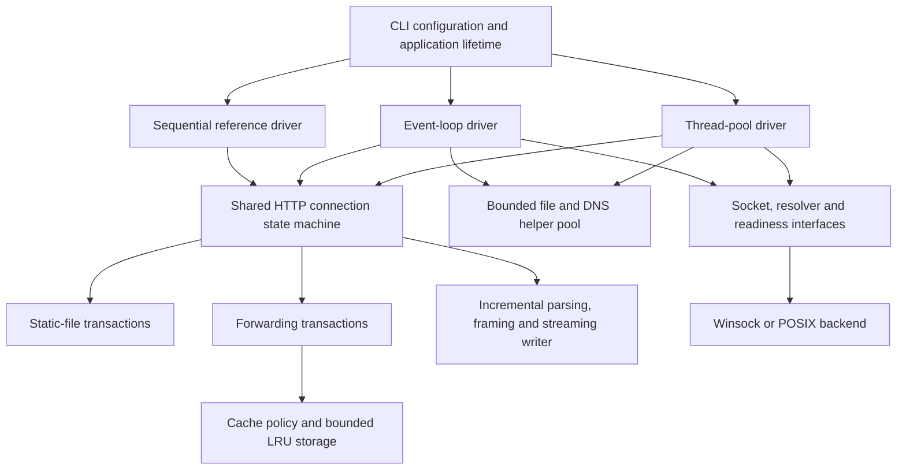

# HTTP Server and Caching Proxy

A C++20 learning project that implements HTTP/1.1 directly on TCP sockets. It can serve static files, forward requests to HTTP origins, and cache eligible responses in bounded memory. The production executable uses only the C++ standard library and OS APIs.

The applications share one HTTP state machine and run with a thread pool or an event loop. A sequential reference driver and the original fixed-response demo remain available.

## Build and run

Requirements: CMake 3.20+, a C++20 compiler, and Ninja or a supported native build tool. Python 3.10+ is needed only when benchmark tooling is enabled.

Run these commands from the repository root:

```powershell
cmake -S . -B build/release -G Ninja -DCMAKE_BUILD_TYPE=Release -DBUILD_TESTING=ON -DBUILD_BENCHMARKS=ON -DREQUIRE_ALL_MILESTONES=ON
cmake --build build/release --parallel
ctest --test-dir build/release -C Release --no-tests=error --output-on-failure
```

With Ninja, the Windows executable is `build/release/httpserver.exe`; on Linux/macOS it is `build/release/httpserver`. For MSVC, use a Developer PowerShell or select the Visual Studio generator, build with `--config Release`, and use `build/release/Release/httpserver.exe`. Use a separate directory for each generator/compiler.

```powershell
# Serve the included www/index.html.
./build/release/httpserver.exe --mode server --root www --concurrency thread-pool --workers 4 --port 8080

# Serve the same application through the event loop.
./build/release/httpserver.exe --mode server --root www --concurrency event-loop --port 8080

# Forward proxy, with an in-memory shared cache.
./build/release/httpserver.exe --mode proxy --concurrency event-loop --cache on --port 8081

# The original persistent fixed-response demo.
./build/release/httpserver.exe --mode demo --concurrency single --port 8080

./build/release/httpserver.exe --help
```

The default bind address is `127.0.0.1`. `--port 0` asks the OS for an available port; startup prints the actual endpoint. Ctrl+C requests shutdown. For a local proxy exercise, run a static server on 8080 and use `curl --noproxy "" --proxy http://127.0.0.1:8081 http://127.0.0.1:8080/`. A response is cached only if its origin metadata and the request satisfy the cache policy.

## Architecture



`application::Runtime` creates configuration-dependent services, the application factory, helper pool and selected driver. The executable owns the network runtime outside that composition. Stop hooks notify normal code; driver threads stop accepting, drain or close their sessions, then join before helpers stop and networking is destroyed. Synchronous OS DNS cannot be interrupted, so a pending resolver can extend helper shutdown beyond the socket drain deadline.

The thread pool has one acceptor, a bounded accepted-socket queue and a fixed number of client workers. Each worker owns its client/upstream sockets and processes one session at a time. File and DNS jobs use separate helper threads.

The event loop owns its sockets and poller on one thread. Readiness, timers, helper completions and runnable sessions each receive bounded processing budgets. It watches writes only when needed, retains offsets across short writes and rejects excess sessions without allocating another session. Helper callbacks are drained on the loop owner; file and DNS operations do not block it.

## How a request works

1. A driver accepts and explicitly configures a socket. Incremental parsing preserves partial messages, repeated fields and bytes belonging to later pipelined requests.
2. The shared session checks method, target, framing and configured limits. Ambiguous framing is rejected. Requests on a connection execute in order.
3. An application transaction returns response metadata/body segments or a typed work request. It does not perform network or file I/O itself.
4. The driver executes socket work, or sends file/DNS work to a helper, then delivers an owning result with connection/transaction/operation identity. Stale completions cannot modify another request.
5. The streaming writer frames the response and the session advances only after acknowledged output. Slow clients apply backpressure. An upstream failure after the response starts closes the incomplete response rather than adding a second status line.

### Static files

The static factory validates and canonicalizes the root at startup. Request paths pass containment and symlink policy checks; directories are not listed. The service provides MIME types, GET/HEAD, validators and conditional responses, reading files in bounded chunks. The same assertions run against both production drivers and the sequential reference path.

### Forward proxy and cache

The forwarding factory accepts absolute cleartext HTTP URLs, regenerates Host from the selected authority, removes hop-by-hop/proxy credential fields, appends Via, and incrementally validates origin response framing. It supports fixed-length, chunked and close-delimited origin bodies with bounded parser windows and phase deadlines.

The caching factory composes forwarding with pure cache policy and synchronized LRU storage. A fresh usable entry serves an immutable body/metadata snapshot; cache-only misses return 504 without origin work. A miss streams to the client while collecting a bounded candidate. Only a completely validated representation can be published.

Stale entries with validators can be revalidated. A valid 304 updates metadata for the exact selected version while sharing its body. A concurrent replacement cannot mix old content with new metadata: a conflicting 304 permits one unconditional refetch. Evicted or replaced entries remain safely readable while pinned, and their allocations still count against the total budget. There is no persistent cache or stale-on-error fallback.

## Configuration and diagnostics

`--help` lists the actual options. They cover application/driver selection, worker/helper counts, client/upstream admission, bounded queues, buffers, timeouts and cache entry/object/resident/total limits. Invalid roots, endpoints, limit relationships and incompatible mode options fail startup.

The session produces one bounded response segment at a time and waits for it to drain before asking for another. The configured output capacity is the active bound; low/high-water settings describe the reserved queue contract rather than a second queued-output implementation. Thread-pool active sessions are bounded by workers; its accept queue is separate. Its completion setting must provide at least one slot per worker. Proxy admission conservatively counts transactions, including cache hits.

The main control thread emits a bounded `METRICS` JSON line each second and at graceful shutdown. Values are process-lifetime totals or current/peak gauges, including queue/session state, proxy/cache activity and available CPU/RSS samples. These snapshots are not automatically measurement-interval deltas. Unsupported samples are `null`.

## Tests and benchmarks

The integrated inventory contains 50 native/script acceptance suites and four optional Python CTests (54 total with `BUILD_BENCHMARKS=ON`). Release builds retain assertions. Strict mode treats pending exit code 77 as failure. The inventory is checked at CMake configuration, and CI is configured to run every registered suite on Windows, Linux and macOS.

Track I exercises real static, uncached-proxy and cached-proxy applications through both drivers, plus the static reference path. It checks independent wire output, pipeline ordering, framing, forwarding, cache hits/revalidation, concurrent readers, blocked-origin cancellation, overload recovery and startup rollback. Feature suites provide additional detailed policy, memory-accounting, deadline and driver checks.

Track J defines reproducible scenario families and records immutable raw repeats, correctness/error counts, histograms and environment/build provenance. Smoke runs exercise all 11 non-demo families with both drivers; they establish operability, not performance rankings.

```powershell
ctest --test-dir build/release -C Release -L milestone31 --no-tests=error --output-on-failure
python benchmarks/benchmark.py run --binary build/release/httpserver.exe --build-dir build/release --scenario proxy-warm --driver event-loop --smoke
```

M adds repeated resource cleanup checks, optional sanitizer instrumentation and source/binary-bound validation records. N adds alternating repeated campaigns, raw-result tables and standalone plots. See the [M guide](docs/branches/correctness-gate.md), [N guide](docs/branches/results.md), and [executed LMN validation](docs/validation/lmn.md). Local candidate measurements are explicitly provisional until matching native platform evidence exists.

```powershell
python tools/qualify.py --build-dir build/release --binary build/release/httpserver.exe --output build/release/qualification.json
python benchmarks/benchmark.py run --binary build/release/httpserver.exe --build-dir build/release --scenario proxy-warm --driver event-loop --warmup 1 --measurement 5 --repeats 5 --candidate-record build/release/qualification.json
```

See [benchmark instructions](benchmarks/README.md), [test documentation](tests/README.md) and the [integration record](docs/branches/application-assembly.md) for commands and earlier platform evidence. New Linux/macOS and race-diagnostic execution remain open; no prior CI result certifies an uncommitted candidate.

## Repository guide

| Location | Responsibility |
| --- | --- |
| `include/core`, `src/core` | Results/errors, clocks, identities, budgets and configuration |
| `include/net`, `src/net` | Portable sockets/readiness and selected OS backend |
| `include/http`, `src/http` | Messages, parsing/framing, streaming responses and shared sessions |
| `include/server`, `src/server` | Static path, MIME and conditional-response policy |
| `include/proxy`, `src/proxy` | Forwarding and cached proxy transactions |
| `include/cache`, `src/cache` | Cache policy and bounded storage |
| `include/concurrency`, `src/concurrency` | Session/work contracts, helpers and drivers |
| `include/observability`, `src/observability` | Metrics, bounded logging, process samples and stop hooks |
| `include/application`, `src/application` | Production composition and lifetime ownership |
| `tests`, `benchmarks` | Acceptance fixtures and reproducible workload tooling |
| `roadmap`, `docs/branches` | Planned work and implementation/verification handoffs |

Start with [IMPLEMENTATION_ROADMAP.md](IMPLEMENTATION_ROADMAP.md) and the [parallel track index](roadmap/README.md). Scope is cleartext HTTP/1.1 GET/HEAD. TLS, CONNECT tunnels, upgrades, HTTP/2/3, dynamic handlers, persistent caches and generated compression are outside the current implementation.
