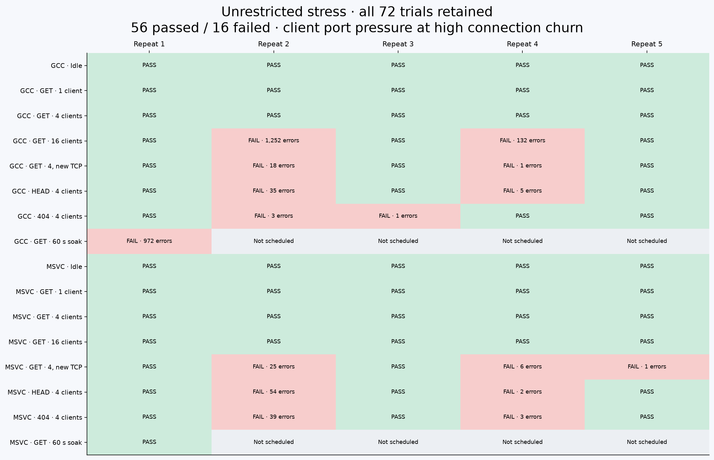
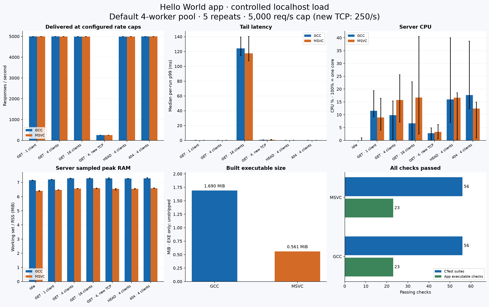
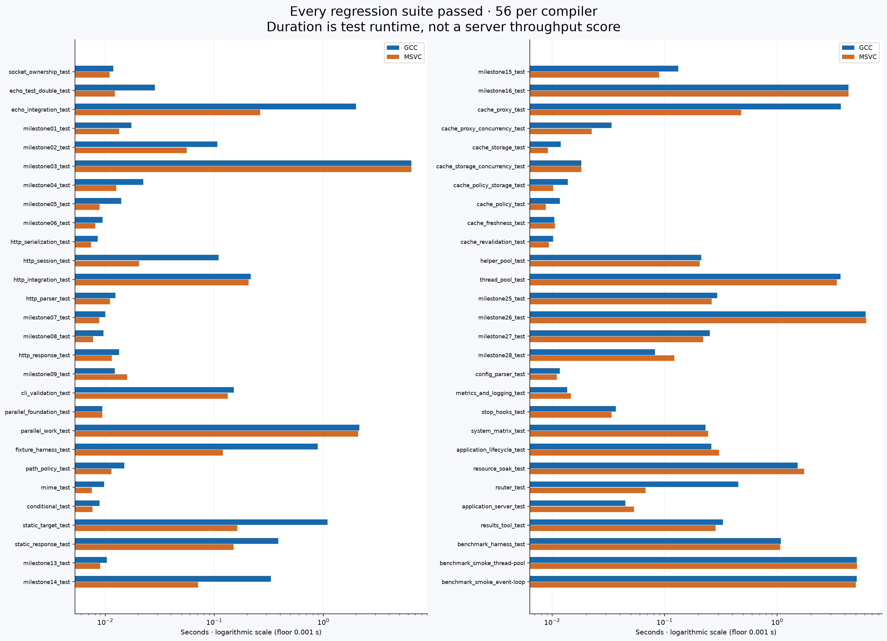
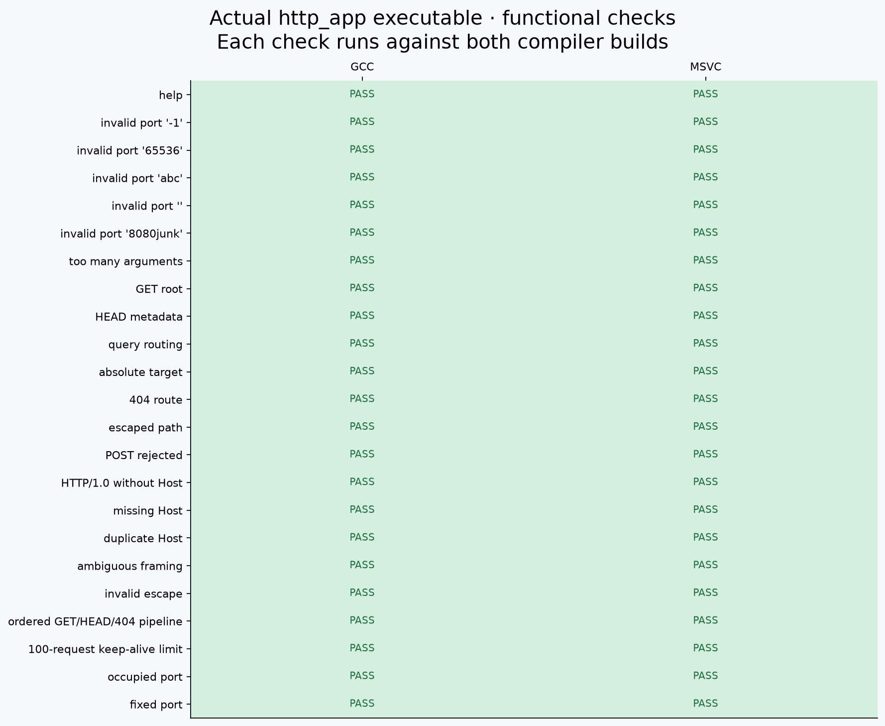
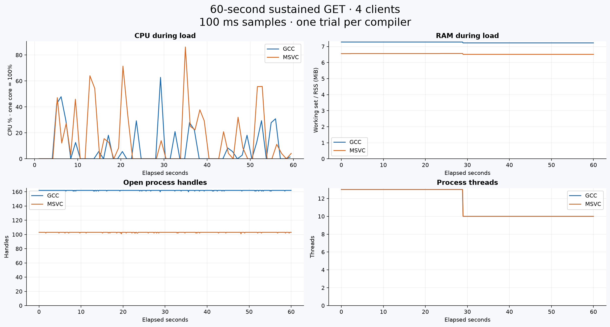

# Hello World app: local Windows results

Measured executable: `http_app`, default four-worker pool, 100 requests per connection, loopback HTTP/1.1. Both the native load generator and server share this host.

Five repeats per point: 1 s warmup and 5 s load, or 3 s idle. Compiler order alternates each round. Each build also runs one 60 s soak. All original trials are retained. These are local candidate measurements, not universal capacity or cross-platform results.

The controlled campaign caps reused-connection workloads at **5000 requests/s**, and new TCP connections at **250 requests/s**. Throughput is delivery at these offered loads, not maximum capacity. The separate unrestricted stress results are retained below, including failures.

CPU uses process user+kernel time divided by sampled wall time; **100% = one logical core**, not the whole machine. RAM is the maximum sampled working set/RSS every 100 ms, including shared pages. Binary size is the built, unstripped executable only, excluding PDBs, DLLs and deployment dependencies. Compiler sizes are affected by linker/runtime settings.

Rates, CPU and sampled peaks below are per-run medians. P50/P95/P99 are **medians of per-run percentiles**, not pooled percentiles. Error bars in graphs show minimum/maximum across five repeats. Full spreads are retained in `summary.json` and `trials.csv`. Soak has only one trial per build.

| Build | Workload | Repeats | Requests/s | P50 ms | P95 ms | P99 ms | CPU % | Peak RAM MiB | Threads | Handles |
| --- | --- | ---: | ---: | ---: | ---: | ---: | ---: | ---: | ---: | ---: |
| gcc | Idle | 5 | — | — | — | — | 0.000 | 7.156 | 13 | 158 |
| msvc | Idle | 5 | — | — | — | — | 0.000 | 6.406 | 13 | 100 |
| gcc | GET · 1 client | 5 | 4,993.459 | 0.026 | 0.062 | 0.211 | 11.539 | 7.207 | 13 | 159 |
| msvc | GET · 1 client | 5 | 4,997.996 | 0.030 | 0.064 | 0.212 | 8.903 | 6.477 | 13 | 101 |
| gcc | GET · 4 clients | 5 | 4,997.760 | 0.051 | 0.093 | 0.220 | 9.794 | 7.297 | 13 | 162 |
| msvc | GET · 4 clients | 5 | 4,986.023 | 0.049 | 0.094 | 0.225 | 15.716 | 6.570 | 13 | 104 |
| gcc | GET · 16 clients | 5 | 4,985.675 | 0.043 | 0.104 | 124.322 | 6.629 | 7.297 | 13 | 174 |
| msvc | GET · 16 clients | 5 | 4,985.580 | 0.044 | 0.103 | 117.663 | 16.686 | 6.590 | 13 | 116 |
| gcc | GET · 4, new TCP | 5 | 249.558 | 0.418 | 0.539 | 0.605 | 2.779 | 7.297 | 13 | 159 |
| msvc | GET · 4, new TCP | 5 | 249.548 | 0.431 | 0.551 | 0.627 | 3.326 | 6.551 | 13 | 101 |
| gcc | HEAD · 4 clients | 5 | 4,985.451 | 0.040 | 0.096 | 0.209 | 15.966 | 7.277 | 13 | 162 |
| msvc | HEAD · 4 clients | 5 | 4,985.986 | 0.041 | 0.097 | 0.224 | 16.621 | 6.547 | 13 | 104 |
| gcc | 404 · 4 clients | 5 | 4,996.779 | 0.050 | 0.096 | 0.233 | 17.632 | 7.293 | 13 | 162 |
| msvc | 404 · 4 clients | 5 | 4,996.632 | 0.051 | 0.093 | 0.227 | 12.435 | 6.594 | 13 | 104 |
| gcc | GET · 60 s soak | 1 | 4,998.754 | 0.039 | 0.092 | 0.190 | 8.475 | 7.281 | 13 | 162 |
| msvc | GET · 60 s soak | 1 | 4,998.787 | 0.040 | 0.092 | 0.196 | 15.199 | 6.566 | 13 | 103 |

## Unrestricted stress: failures retained

**56/72 trials passed; 16 failed** during warmup or measurement. This campaign used the same executable hashes without rate caps. Windows client socket-address errors (10048) and timeouts were recorded; the app's 100-request limit creates substantial connection churn at unrestricted rates. The controlled runs above do not erase these failures.

A read-only diagnostic found the Windows TCP dynamic range was 49,152–65,535 (16,384 ports), with 7,601 client sockets in TIME_WAIT for completed benchmark endpoints at the observation instant. This is evidence of client-side port pressure, not an application HTTP validation failure. No networking settings were changed.

Error counts include warmup and timed measurement, and are shown separately by phase in `summary.json`. Failed trials are not included in the controlled performance medians.

| Native error | Occurrences |
| --- | ---: |
| Only one usage of each socket address (protocol/network address/port) is normally permitted. (os error 10048) | 2,543 |
| timeout | 6 |

The native load generator checks response status and aggregate body bytes; exact content is checked immediately before and after each load run. The functional checks additionally validate bodies, HEAD metadata, malformed requests, pipeline ordering, CLI errors and the 100-request cap. This does not claim per-request body hashing during timed load.

Windows benchmark children are stopped through their owned process handles; this is forced shutdown. Graceful lifecycle and cleanup are covered by the C++ CTest suites, not inferred from benchmark cleanup. A 60-second working-set trace is not proof of leak freedom. CPU/RSS do not include the generator or all kernel networking costs.

## Reproduction

See the root README for qualification and campaign commands. Run `python benchmarks/app_report.py --raw benchmarks/results/app-controlled-2026-10-27 --stress benchmarks/results/app-2026-10-27 --output build/app-report-reproduction` to regenerate figures with matplotlib. `psutil` and `oha` are required only for measurement. Runtime dependencies are unchanged.
