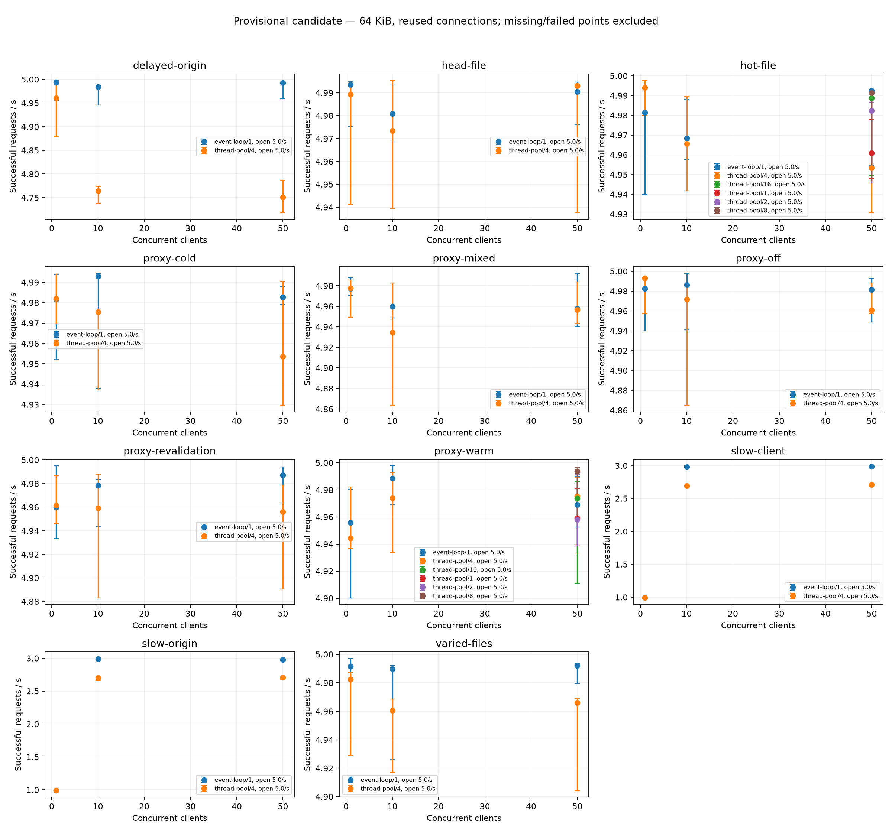
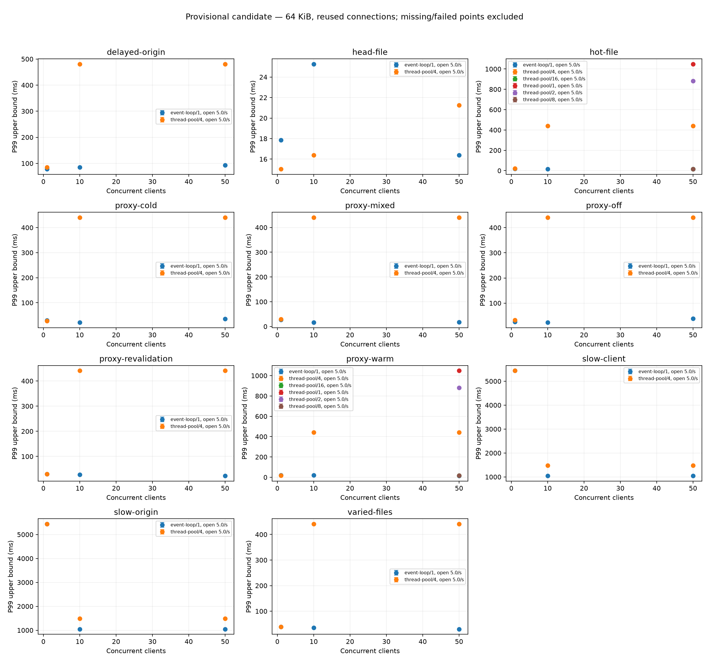

# Local repeated-run results

Provisional candidate evidence; final M qualification is pending.

Rates are per-repeat median [minimum, maximum]. Latencies pool raw histogram counts; values are bucket upper bounds. Failed trials remain in the raw data and error totals. CPU values are cores consumed, not percentages of the machine. RSS is sampled, not a guaranteed peak.

| Family | Driver/workers | Clients | Bytes | Reuse | Passed/total | Requests/s median [min,max] | P99 (ms) | Errors |
| --- | --- | ---: | ---: | --- | ---: | --- | ---: | ---: |
| proxy-cold | event-loop/1 | 1 | 65536 | True | 5/5 | 5.0 [5.0, 5.0] | 30.049 | 0 |
| proxy-cold | thread-pool/4 | 1 | 65536 | True | 5/5 | 5.0 [5.0, 5.0] | 27.555 | 0 |
| proxy-cold | event-loop/1 | 10 | 65536 | True | 5/5 | 5.0 [4.9, 5.0] | 21.248 | 0 |
| proxy-cold | thread-pool/4 | 10 | 65536 | True | 5/5 | 5.0 [4.9, 5.0] | 440.872 | 0 |
| proxy-cold | event-loop/1 | 50 | 65536 | True | 5/5 | 5.0 [5.0, 5.0] | 35.734 | 0 |
| proxy-cold | thread-pool/4 | 50 | 65536 | True | 5/5 | 5.0 [4.9, 5.0] | 440.872 | 0 |
| proxy-mixed | event-loop/1 | 1 | 65536 | True | 5/5 | 5.0 [5.0, 5.0] | 27.555 | 0 |
| proxy-mixed | thread-pool/4 | 1 | 65536 | True | 5/5 | 5.0 [4.9, 5.0] | 30.049 | 0 |
| proxy-mixed | event-loop/1 | 10 | 65536 | True | 5/5 | 5.0 [4.9, 5.0] | 16.384 | 0 |
| proxy-mixed | thread-pool/4 | 10 | 65536 | True | 5/5 | 4.9 [4.9, 5.0] | 440.872 | 0 |
| proxy-mixed | event-loop/1 | 50 | 65536 | True | 5/5 | 5.0 [4.9, 5.0] | 17.867 | 0 |
| proxy-mixed | thread-pool/4 | 50 | 65536 | True | 5/5 | 5.0 [4.9, 5.0] | 440.872 | 0 |
| delayed-origin | event-loop/1 | 1 | 65536 | True | 5/5 | 5.0 [5.0, 5.0] | 77.936 | 0 |
| proxy-off | event-loop/1 | 1 | 65536 | True | 5/5 | 5.0 [4.9, 5.0] | 25.268 | 0 |
| slow-origin | event-loop/1 | 1 | 65536 | True | 5/5 | 1.0 [1.0, 1.0] | 5439.340 | 0 |
| delayed-origin | thread-pool/4 | 1 | 65536 | True | 5/5 | 5.0 [4.9, 5.0] | 84.990 | 0 |
| proxy-off | thread-pool/4 | 1 | 65536 | True | 5/5 | 5.0 [5.0, 5.0] | 32.768 | 0 |
| slow-origin | thread-pool/4 | 1 | 65536 | True | 5/5 | 1.0 [1.0, 1.0] | 5439.340 | 0 |
| delayed-origin | event-loop/1 | 10 | 65536 | True | 5/5 | 5.0 [4.9, 5.0] | 84.990 | 0 |
| proxy-off | event-loop/1 | 10 | 1024 | True | 5/5 | 5.0 [5.0, 5.0] | 19.484 | 0 |
| proxy-off | event-loop/1 | 10 | 1048576 | True | 5/5 | 5.0 [4.9, 5.0] | 32.768 | 0 |
| proxy-off | event-loop/1 | 10 | 16777216 | True | 5/5 | 5.0 [4.9, 5.0] | 92.682 | 0 |
| proxy-off | event-loop/1 | 10 | 65536 | False | 5/5 | 5.0 [4.9, 5.0] | 21.248 | 0 |
| proxy-off | event-loop/1 | 10 | 65536 | True | 5/5 | 5.0 [4.9, 5.0] | 23.171 | 0 |
| slow-origin | event-loop/1 | 10 | 65536 | True | 5/5 | 3.0 [3.0, 3.0] | 1048.576 | 0 |
| delayed-origin | thread-pool/4 | 10 | 65536 | True | 5/5 | 4.8 [4.7, 4.8] | 480.775 | 0 |
| proxy-off | thread-pool/4 | 10 | 1024 | True | 5/5 | 4.9 [4.9, 5.0] | 440.872 | 0 |
| proxy-off | thread-pool/4 | 10 | 1048576 | True | 5/5 | 4.9 [4.9, 5.0] | 440.872 | 0 |
| proxy-off | thread-pool/4 | 10 | 16777216 | True | 5/5 | 4.8 [4.7, 4.9] | 480.775 | 0 |
| proxy-off | thread-pool/4 | 10 | 65536 | False | 5/5 | 5.0 [5.0, 5.0] | 38.968 | 0 |
| proxy-off | thread-pool/4 | 10 | 65536 | True | 5/5 | 5.0 [4.9, 5.0] | 440.872 | 0 |
| slow-origin | thread-pool/4 | 10 | 65536 | True | 5/5 | 2.7 [2.7, 2.7] | 1482.911 | 0 |
| delayed-origin | event-loop/1 | 50 | 65536 | True | 5/5 | 5.0 [5.0, 5.0] | 92.682 | 0 |
| proxy-off | event-loop/1 | 50 | 65536 | True | 5/5 | 5.0 [4.9, 5.0] | 38.968 | 0 |
| slow-origin | event-loop/1 | 50 | 65536 | True | 5/5 | 3.0 [3.0, 3.0] | 1048.576 | 0 |
| delayed-origin | thread-pool/4 | 50 | 65536 | True | 5/5 | 4.8 [4.7, 4.8] | 480.775 | 0 |
| proxy-off | thread-pool/4 | 50 | 65536 | True | 5/5 | 5.0 [5.0, 5.0] | 440.872 | 0 |
| slow-origin | thread-pool/4 | 50 | 65536 | True | 5/5 | 2.7 [2.7, 2.7] | 1482.911 | 0 |
| proxy-revalidation | event-loop/1 | 1 | 65536 | True | 5/5 | 5.0 [4.9, 5.0] | 30.049 | 0 |
| proxy-revalidation | thread-pool/4 | 1 | 65536 | True | 5/5 | 5.0 [4.9, 5.0] | 30.049 | 0 |
| proxy-revalidation | event-loop/1 | 10 | 65536 | True | 5/5 | 5.0 [4.9, 5.0] | 27.555 | 0 |
| proxy-revalidation | thread-pool/4 | 10 | 65536 | True | 5/5 | 5.0 [4.9, 5.0] | 440.872 | 0 |
| proxy-revalidation | event-loop/1 | 50 | 65536 | True | 5/5 | 5.0 [5.0, 5.0] | 23.171 | 0 |
| proxy-revalidation | thread-pool/4 | 50 | 65536 | True | 5/5 | 5.0 [4.9, 5.0] | 440.872 | 0 |
| proxy-warm | event-loop/1 | 1 | 65536 | True | 5/5 | 5.0 [4.9, 5.0] | 21.248 | 0 |
| proxy-warm | thread-pool/4 | 1 | 65536 | True | 5/5 | 4.9 [4.9, 5.0] | 16.384 | 0 |
| proxy-warm | event-loop/1 | 10 | 1024 | True | 5/5 | 5.0 [5.0, 5.0] | 15.025 | 0 |
| proxy-warm | event-loop/1 | 10 | 1048576 | True | 5/5 | 5.0 [5.0, 5.0] | 311.744 | 0 |
| proxy-warm | event-loop/1 | 10 | 16777216 | True | 5/5 | 5.0 [4.9, 5.0] | 32.768 | 0 |
| proxy-warm | event-loop/1 | 10 | 65536 | True | 5/5 | 5.0 [5.0, 5.0] | 19.484 | 0 |
| proxy-warm | thread-pool/4 | 10 | 1024 | True | 5/5 | 5.0 [4.9, 5.0] | 440.872 | 0 |
| proxy-warm | thread-pool/4 | 10 | 1048576 | True | 5/5 | 5.0 [4.9, 5.0] | 440.872 | 0 |
| proxy-warm | thread-pool/4 | 10 | 16777216 | True | 5/5 | 4.9 [4.9, 4.9] | 440.872 | 0 |
| proxy-warm | thread-pool/4 | 10 | 65536 | True | 5/5 | 5.0 [4.9, 5.0] | 440.872 | 0 |
| proxy-warm | event-loop/1 | 50 | 65536 | True | 5/5 | 5.0 [5.0, 5.0] | 15.025 | 0 |
| proxy-warm | thread-pool/16 | 50 | 65536 | True | 5/5 | 5.0 [4.9, 5.0] | 16.384 | 0 |
| proxy-warm | thread-pool/1 | 50 | 65536 | True | 5/5 | 5.0 [4.9, 5.0] | 1048.576 | 0 |
| proxy-warm | thread-pool/2 | 50 | 65536 | True | 5/5 | 5.0 [4.9, 5.0] | 881.744 | 0 |
| proxy-warm | thread-pool/4 | 50 | 65536 | True | 5/5 | 5.0 [4.9, 5.0] | 440.872 | 0 |
| proxy-warm | thread-pool/8 | 50 | 65536 | True | 5/5 | 5.0 [5.0, 5.0] | 17.867 | 0 |
| head-file | event-loop/1 | 1 | 65536 | True | 5/5 | 5.0 [5.0, 5.0] | 17.867 | 0 |
| hot-file | event-loop/1 | 1 | 65536 | True | 5/5 | 5.0 [4.9, 5.0] | 17.867 | 0 |
| head-file | thread-pool/4 | 1 | 65536 | True | 5/5 | 5.0 [4.9, 5.0] | 15.025 | 0 |
| hot-file | thread-pool/4 | 1 | 65536 | True | 5/5 | 5.0 [5.0, 5.0] | 21.248 | 0 |
| varied-files | event-loop/1 | 1 | 65536 | True | 5/5 | 5.0 [5.0, 5.0] | 38.968 | 0 |
| varied-files | thread-pool/4 | 1 | 65536 | True | 5/5 | 5.0 [4.9, 5.0] | 38.968 | 0 |
| head-file | event-loop/1 | 10 | 65536 | False | 5/5 | 5.0 [5.0, 5.0] | 30.049 | 0 |
| head-file | event-loop/1 | 10 | 65536 | True | 5/5 | 5.0 [5.0, 5.0] | 25.268 | 0 |
| hot-file | event-loop/1 | 10 | 1024 | True | 5/5 | 5.0 [5.0, 5.0] | 23.171 | 0 |
| hot-file | event-loop/1 | 10 | 1048576 | True | 5/5 | 5.0 [4.9, 5.0] | 19.484 | 0 |
| hot-file | event-loop/1 | 10 | 16777216 | True | 5/5 | 5.0 [5.0, 5.0] | 46.341 | 0 |
| hot-file | event-loop/1 | 10 | 65536 | False | 5/5 | 5.0 [4.9, 5.0] | 15.025 | 0 |
| hot-file | event-loop/1 | 10 | 65536 | True | 5/5 | 5.0 [5.0, 5.0] | 16.384 | 0 |
| head-file | thread-pool/4 | 10 | 65536 | False | 5/5 | 5.0 [5.0, 5.0] | 16.384 | 0 |
| head-file | thread-pool/4 | 10 | 65536 | True | 5/5 | 5.0 [4.9, 5.0] | 16.384 | 0 |
| hot-file | thread-pool/4 | 10 | 1024 | True | 5/5 | 5.0 [5.0, 5.0] | 440.872 | 0 |
| hot-file | thread-pool/4 | 10 | 1048576 | True | 5/5 | 5.0 [4.9, 5.0] | 440.872 | 0 |
| hot-file | thread-pool/4 | 10 | 16777216 | True | 5/5 | 4.9 [4.8, 4.9] | 480.775 | 0 |
| hot-file | thread-pool/4 | 10 | 65536 | False | 5/5 | 5.0 [5.0, 5.0] | 13.778 | 0 |
| hot-file | thread-pool/4 | 10 | 65536 | True | 5/5 | 5.0 [4.9, 5.0] | 440.872 | 0 |
| varied-files | event-loop/1 | 10 | 1024 | True | 5/5 | 5.0 [5.0, 5.0] | 16.384 | 0 |
| varied-files | event-loop/1 | 10 | 1048576 | True | 5/5 | 5.0 [5.0, 5.0] | 32.768 | 0 |
| varied-files | event-loop/1 | 10 | 16777216 | True | 5/5 | 5.0 [5.0, 5.0] | 38.968 | 0 |
| varied-files | event-loop/1 | 10 | 65536 | True | 5/5 | 5.0 [4.9, 5.0] | 35.734 | 0 |
| varied-files | thread-pool/4 | 10 | 1024 | True | 5/5 | 5.0 [5.0, 5.0] | 440.872 | 0 |
| varied-files | thread-pool/4 | 10 | 1048576 | True | 5/5 | 5.0 [5.0, 5.0] | 440.872 | 0 |
| varied-files | thread-pool/4 | 10 | 16777216 | True | 5/5 | 4.9 [4.9, 4.9] | 440.872 | 0 |
| varied-files | thread-pool/4 | 10 | 65536 | True | 5/5 | 5.0 [4.9, 5.0] | 440.872 | 0 |
| head-file | event-loop/1 | 50 | 65536 | True | 5/5 | 5.0 [5.0, 5.0] | 16.384 | 0 |
| hot-file | event-loop/1 | 50 | 65536 | True | 5/5 | 5.0 [5.0, 5.0] | 16.384 | 0 |
| head-file | thread-pool/4 | 50 | 65536 | True | 5/5 | 5.0 [4.9, 5.0] | 21.248 | 0 |
| hot-file | thread-pool/16 | 50 | 65536 | True | 5/5 | 5.0 [4.9, 5.0] | 16.384 | 0 |
| hot-file | thread-pool/1 | 50 | 65536 | True | 5/5 | 5.0 [4.9, 5.0] | 1048.576 | 0 |
| hot-file | thread-pool/2 | 50 | 65536 | True | 5/5 | 5.0 [4.9, 5.0] | 881.744 | 0 |
| hot-file | thread-pool/4 | 50 | 65536 | True | 5/5 | 5.0 [4.9, 5.0] | 440.872 | 0 |
| hot-file | thread-pool/8 | 50 | 65536 | True | 5/5 | 5.0 [4.9, 5.0] | 15.025 | 0 |
| varied-files | event-loop/1 | 50 | 65536 | True | 5/5 | 5.0 [5.0, 5.0] | 30.049 | 0 |
| varied-files | thread-pool/4 | 50 | 65536 | True | 5/5 | 5.0 [4.9, 5.0] | 440.872 | 0 |
| slow-client | event-loop/1 | 1 | 65536 | True | 5/5 | 1.0 [1.0, 1.0] | 5439.340 | 0 |
| slow-client | thread-pool/4 | 1 | 65536 | True | 5/5 | 1.0 [1.0, 1.0] | 5439.340 | 0 |
| slow-client | event-loop/1 | 10 | 65536 | True | 5/5 | 3.0 [3.0, 3.0] | 1048.576 | 0 |
| slow-client | thread-pool/4 | 10 | 65536 | True | 5/5 | 2.7 [2.7, 2.7] | 1482.911 | 0 |
| slow-client | event-loop/1 | 50 | 65536 | True | 5/5 | 3.0 [3.0, 3.0] | 1048.576 | 0 |
| slow-client | thread-pool/4 | 50 | 65536 | True | 5/5 | 2.7 [2.7, 2.7] | 1482.911 | 0 |

The server, Python generator and origin share one host. Generator saturation, short intervals, filesystem cache and unequal CPU budgets limit interpretation. These results do not establish a universal driver ranking. Exact settings, raw histograms, origin counts and process-lifetime cache/queue samples are in summary.json and each raw record.

