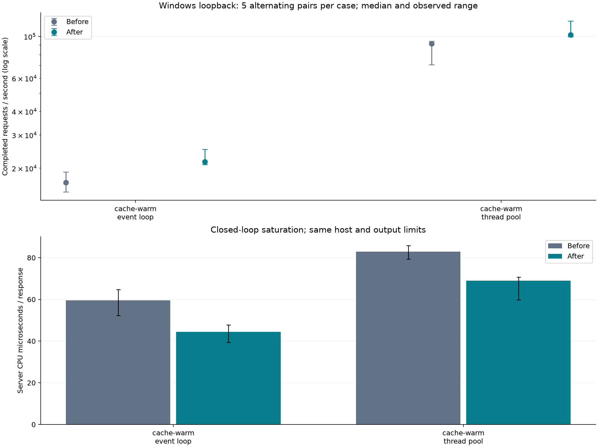

# Cached output follow-up — 2026-10-27

This follow-up compares against the already optimized binary from the
[first investigation](RESULTS.md), including its metadata and retained-poller
changes. The original measurements and binaries remain separate.

## Measured result

Five alternating before/after pairs per driver completed all 20 trials:
**11,687,369 HTTP 200 responses**, zero measured response errors, and zero measured
origin requests. Each trial uses a 64 KiB warm-cache object, 16 clients, 16
thread-pool workers (or one event loop), four helpers, two seconds of warmup and
ten seconds of measured saturation. Both binaries use the same MSVC Release/PDB
flags and default 64 KiB output limit. No build or test campaign ran during load.

| Driver | Before req/s | After req/s | Median paired throughput gain | Before CPU us/response | After CPU us/response | Median paired CPU reduction |
|---|---:|---:|---:|---:|---:|---:|
| Event loop | 16,794 | 21,633 | +24.4% | 59.5 | 44.4 | 19.7% |
| Thread pool | 91,683 | 102,049 | +18.3% | 82.9 | 69.0 | 19.5% |

The before/after columns are medians of five trials. Percentage changes are
medians of within-pair changes, which differ from ratios of aggregate medians.
Every pair improved throughput: +12.1% to +68.1% for the event loop and +8.3% to
+41.4% for the thread pool. This substantial variation limits precision.

Median trial p99 changed from 2.071 to 1.816 ms on the event loop and from 0.414
to 0.432 ms on the thread pool. Individual pairs sometimes worsened p99; this
change does not establish a universal tail-latency improvement.

Median sampled peak RSS changed from 7.03 to 7.90 MiB on the event loop and
8.17 to 9.45 MiB on the thread pool. Median peak handles stayed at 99/180.
The event loop remained near one CPU core; the pool used about 7.4 cores before
and 7.0 after. Generator CPU used about 1.0–1.1 cores for the loop and 3.1–3.4
for the pool. These drivers have different CPU execution budgets.



[Raw trial order and identity](raw/cached-output-paired/paired-manifest.json),
[individual results and ranges](cached-output-summary.json), and
[build identity](cached-output-build.json) are retained. The original body
precheck, HTTP status/byte-count checks and zero-origin checks run in every trial.
This is one Windows host using loopback and a shared load generator; scheduling
and thermal state are not isolated. No speedup is claimed for other object sizes,
static files, cache misses, uncached forwarding, other platforms, or WAN traffic.

## Change and bounds

`CacheTransaction` previously limited every cached body segment to the upstream
`max_read_bytes` setting (16 KiB by default). The resident body does not require
an upstream read. It now emits up to the smaller of the downstream capacity,
the transaction's response window, and the remaining body bytes.

A 64 KiB cached representation therefore needs one application body segment
instead of four with the default 64 KiB output window. This reduces segment
allocations, writer calls and opportunities for socket calls. The head is still
sent separately. Actual socket writes can split on native short writes or the
event loop's unchanged per-turn byte budget.

Each segment still drains before the next is requested. The common writer keeps
partial-write offsets, framing, output deadlines and cancellation behavior.
Cache snapshots remain pinned until the last segment drains. Origin reads and
uncached forwarding retain their existing limits. No CLI defaults, dependencies,
cache policy or driver fairness budgets changed.

The temporary cached segment can now use the full configured output window;
the writer copy can coexist with it during delivery. With default settings,
that segment grows from at most 16 KiB to at most 64 KiB. This is bounded session
output memory, separate from retained cache storage accounting.

## Correctness evidence

All 54 strict suites passed without failures or skips on Windows:

| Compiler | CTest time | Evidence |
|---|---:|---|
| GCC 16.2 | 54.24 s | [qualification](validation/cached-output-gcc.json), [JUnit](validation/cached-output-gcc.junit.xml) |
| MSVC 19.29 | 44.46 s | [qualification](validation/cached-output-msvc-final.json), [JUnit](validation/cached-output-msvc-final.junit.xml) |

The expanded `cache_proxy_test` fills the production cache through the forwarding
parser, then serves a 128 KiB-plus-13-byte binary body through the real session
and writer. It checks 8 KiB and 64 KiB windows, the number of full-progress writes,
short writes, would-block/resume, complete byte equality, final partial segments,
zero extra origin connections and reader release. Transaction-level checks also
vary demand between segments and cap oversized demand at the response window.
Existing suites cover both production drivers, eviction, cancellation, framing,
slow consumers and resource cleanup.

The first sandboxed socket attempt was blocked by Windows error 10013. Complete
gates ran with loopback access. An initial parallel MSVC build was interrupted
after making no progress; the serial build completed. The recorder's refusal to
overwrite that first build log is retained in
[the failed recording attempt](validation/cached-output-msvc.json). The later
`cached-output-msvc-final` record is the successful complete qualification.

These changes have not been tested on Linux/macOS or under sanitizers. Earlier
platform and sanitizer records describe earlier source revisions.

## Reproduction

Keep `build/performance-optimized` as the previous binary. Configure
`build/performance-next` with the identical MSVC Release/PDB settings in
[REPRODUCE.md](REPRODUCE.md), then build with
`cmake --build build/performance-next --config Release -- /m:1 /nr:false`.
Use a fresh qualification filename for each run.

```powershell
& build/lmn-tools/Scripts/python.exe tools/qualify.py --build-dir build/performance-next --binary build/performance-next/Release/httpserver.exe --output "performance testing/validation/new-cached-output-msvc.json" --jobs 1

& build/lmn-tools/Scripts/python.exe "performance testing/run_pairs.py" --before build/performance-optimized/Release/httpserver.exe --before-record "performance testing/optimized-build.json" --after build/performance-next/Release/httpserver.exe --output "performance testing/raw/new-cached-output-paired" --cases cache-warm --duration 10 --warmup 2 --repeats 5

& build/lmn-tools/Scripts/python.exe "performance testing/compare_pairs.py" --study "performance testing/raw/new-cached-output-paired" --summary "performance testing/new-cached-output-summary.json" --plot "performance testing/new-cached-output-comparison"
```

The pairing script accepts selected workloads and a previous build record,
verifies its binary hash, and records both source identities. The report script
accepts explicit input/output paths so another comparison preserves older reports.
Run benchmarks without a concurrent build or test campaign.
