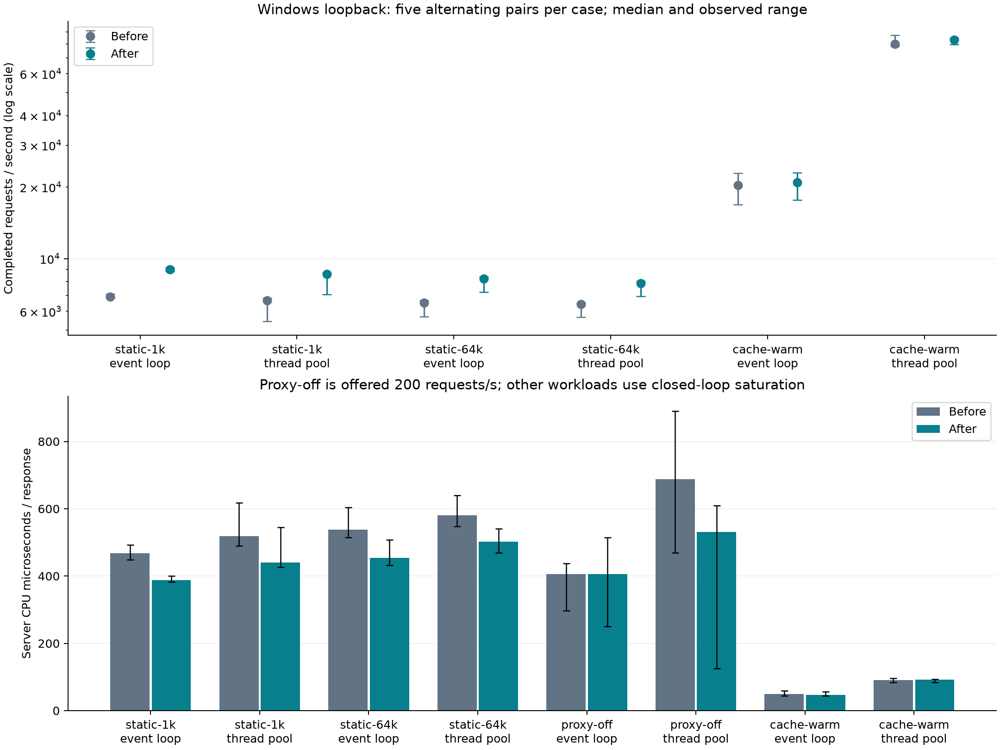

# Findings and measured effect of the changes

The [baseline report](BASELINE.md) was written before modifying production code.
The selected changes improve two measured bottlenecks. They do not remove the
remaining uncached-proxy connection-capacity limit described below.

## Paired comparison

There are five alternating original/optimized pairs for each workload and driver:
80 successful trials, 6,627,877 HTTP 200 responses, zero measured response errors.
Each uses 16 clients, four helpers, 16 thread-pool workers, 1 s warmup and 5 s
measured load. Pair order reverses on alternate repetitions. The initial baseline
separately used five 10 s trials per workload/driver. Both binaries use identical
MSVC optimized Release/PDB flags; source and binary fingerprints are recorded.

Static and warm-cache cases use closed-loop saturation. Proxy-off is deliberately
held at **200 aggregate requests/s**, so it measures latency/cost at that rate,
not maximum capacity. Numbers below are medians of five trials. Percentage
changes are medians of within-pair changes, which need not equal ratios of
aggregate medians. P99 is a median of per-trial percentiles, not a pooled value.

| Workload | Driver | Before req/s | After req/s | Paired throughput change | Before p99 ms | After p99 ms | Before CPU us/response | After CPU us/response |
|---|---|---:|---:|---:|---:|---:|---:|---:|
| Static 1 KiB | event loop | 6,906 | 9,011 | +29.0% | 3.919 | 2.955 | 468.0 | 387.7 |
| Static 1 KiB | thread pool | 6,672 | 8,612 | +29.3% | 3.908 | 3.091 | 518.4 | 440.8 |
| Static 64 KiB | event loop | 6,505 | 8,238 | +26.4% | 4.150 | 3.250 | 537.9 | 454.5 |
| Static 64 KiB | thread pool | 6,435 | 7,855 | +23.3% | 3.884 | 3.293 | 580.6 | 501.9 |
| Proxy off, offered 200/s | event loop | 200 | 200 | approximately 0% | 2.240 | 1.835 | 405.8 | 406.2 |
| Proxy off, offered 200/s | thread pool | 200 | 200 | approximately 0% | 23.636 | 1.845 | 688.2 | 530.7 |
| Warm cache 64 KiB | event loop | 20,361 | 20,964 | +0.3% | 1.632 | 1.616 | 49.2 | 47.1 |
| Warm cache 64 KiB | thread pool | 79,871 | 83,293 | +0.8% | 0.554 | 0.505 | 90.7 | 92.5 |

Every static pair improved throughput, with individual gains of +20.9% to
+33.3%. Median paired CPU reductions are 18.1%/11.8% for 1 KiB and 16.0%/14.2%
for 64 KiB (event loop/thread pool). Thread-pool proxy median paired CPU fell
25.1% and p99 fell 92.4%. One optimized proxy trial still had 16.06 ms p99,
versus approximately 1.65–1.90 ms in the others; the median is not a worst-case
guarantee. [Individual trials and ranges](paired-summary.json).

Warm-cache paths serve as controls: their median paired throughput changes are
below 1%, with substantial individual variation. No cache speedup or event-loop
forwarding CPU improvement is attributed to the changes.

## Static-file bottleneck and change

Baseline busiest threads were file helpers. `file_metadata` occupied 81.7%/79.0%
of sampled helper elapsed time; snapshots showed four helpers active and roughly
10–12 jobs queued. Generator CPU was low, supporting a server-side bottleneck.

[`file_metadata.cpp`](../src/concurrency/file_metadata.cpp) now obtains final-file
type and size from the same Windows attribute query used by the component walk.
Separate status/size queries are removed. Every parent reparse check, canonical
containment, opened-stream length and standard-library timestamp conversion
remains. Metadata is not cached between requests.

| Capture | Before | After |
|---|---|---|
| Event-loop helper | [flame graph](flamegraphs/baseline-profiles-static-1k-event-loop-c16-r1.svg) | [flame graph](flamegraphs/optimized-profiles-static-1k-event-loop-c16-r1.svg) |
| Thread-pool helper | [flame graph](flamegraphs/baseline-profiles-static-1k-thread-pool-c16-r1.svg) | [flame graph](flamegraphs/optimized-profiles-static-1k-thread-pool-c16-r1.svg) |

Metadata remains the largest helper cost after optimization (76.8%/77.7% of
sampled elapsed time), while more requests finish per second. Remaining component
checks and canonicalization have a correctness purpose and were not removed.

## Thread-pool proxy bottleneck and change

[`work.cpp`](../src/concurrency/work.cpp) previously built a new `Poller` for
every synchronous upstream wait, establishing a new loopback TCP wake pair each
time. It now retains one lazy poller per executor. Each wait registers/unregisters
its socket, preserving generations, candidate retries, owner-thread rules and
cancellation. Creation uses the work deadline. File/DNS-only helper executors
allocate no poller.

Cumulative host IPv4 counters show median active opens per response falling from
**3.092 to 1.117**; the event-loop control stays **1.091 to 1.092**. These counters
include startup, warmup, generator connections and unrelated host traffic, so
they are not exact application call counts. The roughly two-opens/request
reduction matches the removed wake-channel construction.

[Before all-thread proxy graph](flamegraphs/baseline-proxy-profile-proxy-off-thread-pool-c16-r1.svg)
contains `Poller::create` stacks; [after](flamegraphs/optimized-proxy-profile-proxy-off-thread-pool-c16-r1.svg)
has no sampled creation frames. Startup still creates pollers.

The bounded tradeoff is two retained wake sockets per active executor. Observed
thread-pool proxy peak handles rose from 192 to 219; the native resource-soak
suite checks release at destruction. Sampled peak RSS in that workload fell from
9.12 to 7.74 MiB. Static workloads stayed approximately 8–10.2 MiB. Short benchmark
runs alone do not establish leak freedom.

## Other observed limits

Warm-cache event-loop traffic uses approximately one CPU core and no measured
origin requests. Its [profile](flamegraphs/baseline-profiles-cache-warm-event-loop-c16-r1.svg)
places 55.9% of selected-thread elapsed samples under socket writes. The thread
pool uses more cores for higher throughput and higher CPU/response. This does
not identify cache locking as the dominant bottleneck. Coalesced writes or
scatter/gather output are future experiments requiring framing, short-write and
backpressure tests; no speculative cache redesign was made.

The initial baseline smoke returned 463 HTTP 200 and 208 HTTP 502 responses in
its measured thread-pool proxy window. It is retained and excluded from qualified
throughput comparisons.

The optimized follow-up in `raw/optimized-proxy-saturation` completed 15,352 HTTP
200 responses through the event loop at about 5,090 requests/s. The following
thread-pool trial served 10,314 HTTP 200 responses in its one-second warmup, then
4,170 HTTP 200 and 579 HTTP 502 responses in the measured window; oha also recorded
12 socket errors. The origin-statistics read failed with **Windows error 10048
(address/port already in use)**. Raw oha output survives the observer failure.
This run remains failed and is not reported as a throughput improvement.

The host's dynamic TCP range is 49,152–65,535, only 16,384 ports. Poller reuse
removes two avoidable connections per request, but one origin connection per
uncached request can still exhaust port/TIME_WAIT capacity. Prior runs also
contribute host state. No global TCP settings were changed; all owned children
were stopped and transient TCP state was allowed to drain.

Sustained high-rate uncached forwarding needs a separate bounded origin
keep-alive/reuse design: authority isolation, clean framed-body completion,
stale-connection handling, cancellation, idle expiry and capacity limits need
acceptance checks. That feature was not implemented here. Downstream keepalive
and warm-cache hits already avoid their respective connection costs.

## Verification, tools and limitations

All **54 strict suites pass on Windows MSVC, GCC, Clang and MSVC AddressSanitizer**.
The ten supplemental native-junction/static-response checks also pass across
both drivers. Full records and host limitations are in [VALIDATION.md](VALIDATION.md).
Source identity is `dd61ed1349d8a31de0d515d4ca66c9fd00b69e49ecbd72650e62f9609006fb79`.

Very Sleepy supplies **sampled thread wall time including waits**, not hardware
CPU-event samples. Process CPU is measured separately. Busiest-thread and
all-thread percentages have different denominators. Some OS symbols resolve only
to exported neighbors; conclusions use project call chains/API callers.
Profiled runs are separate from the unprofiled comparison.

Tools used: oha 1.16.0, Very Sleepy 0.91, pinned FlameGraph renderer, psutil 7.2.2,
matplotlib 3.11.2, Python 3.14.0 and Node 22.20.0 for the controlled local origin.
Hashes and commands are retained; none adds a production dependency.

Measurements use warm filesystem caches and loopback on one Windows host. No
cold-disk, WAN, multi-machine, hardware-counter, multi-hour or race-instrumented
study was run. Shared-host scheduling and thermal state were not isolated.
Merged LMN CI passed Windows/Linux/macOS and Linux ASan/UBSan; **the later
performance changes have not run on Linux/macOS**. No cross-platform speedup is
claimed. The full milestone 32 campaign remains broader than this investigation.
These finite results establish specific improvements, not that every workload
is bottleneck-free. See [REPRODUCE.md](REPRODUCE.md) to rerun or extend the study.
